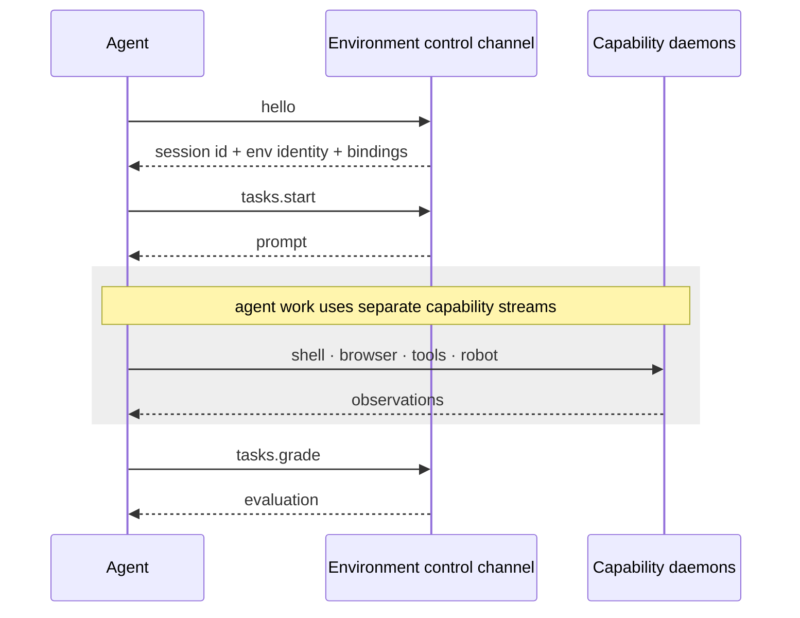
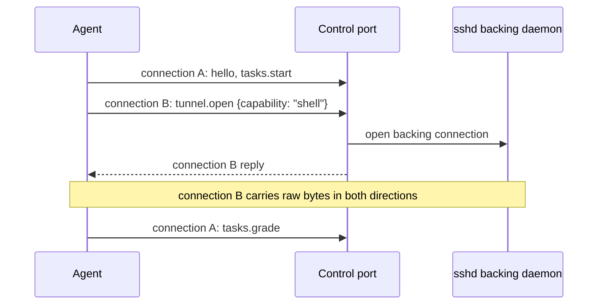

The control channel is the boundary between the process driving an agent and the
served environment it acts on. A served environment exposes one TCP address.
Task setup, grading, session state, and live capability tunnels all pass through
connections to that address.

Three roles meet at this boundary:

| Role | Wire responsibility |
| --- | --- |
| **Agent** | Drives a `Run`, reads the prompt, and opens capabilities through `HudClient`. |
| **Environment** | Serves task templates and the backing daemons named by its capability bindings. |
| **Capability** | Describes a live protocol endpoint such as `ssh`, `mcp`, `cdp`, `rfb`, or `robot`. |

The channel contains two related contracts:

| Concept | What it is |
| --- | --- |
| **Control session** | A framed JSON-RPC dialogue over one connection: `hello`, `tasks.start`, `tasks.grade`, and related methods. |
| **Capability stream** | A raw byte tunnel over a separate connection, splicing the client to a backing capability daemon. |
| **Preface frame** | The first frame on a connection; it selects a control session or a capability stream. |

## The run loop on the wire



`hello` opens a session, or attaches to an open one by id, and returns the environment identity plus
its capability bindings. `tasks.start` advances one task generator to its first
yield and returns the prompt. The agent drives the advertised capabilities while
that generator remains suspended. `tasks.grade` sends the agent's answer into
the generator and returns its second yield as an evaluation.

The environment defines what can be acted on and how the resulting state is
graded. The agent harness defines the action loop. Their only shared contract is
the channel and the capability protocols named by its bindings.

## Session methods

A control session speaks JSON-RPC 2.0 for the connection's lifetime:

| Method | Result |
| --- | --- |
| `hello` | Session id, environment name/version, and capability `bindings`. On a connection's first `hello`, `session_id` attaches to an open session instead of opening one. `lease` keeps the session open that many seconds after the connection ends (default 0). |
| `tasks.list` | Registered task metadata for introspection and validation. |
| `tasks.start` | The selected task's first yield, normalized to a prompt frame. |
| `tasks.grade` | The selected task's evaluation, including numeric `score`. |
| `tasks.cancel` | Interrupts a running `tasks.start` or `tasks.grade`, then cancels and removes the session's task. |
| `bye` | Closes the session, cancelling its task, and ends the connection. |

Each request and response is one newline-delimited JSON frame. Calls on a
`HudClient` are serialized, and reply ids must match the corresponding request.
A malformed or unknown call receives a JSON-RPC error frame. A rollout that gives
up on its task sends `tasks.cancel` at once, even while another call is in flight.

Control requests and responses support up to **16 MiB (16,777,216 bytes)** of
encoded JSON, including the JSON-RPC wrapper and escaped strings, excluding the
trailing newline. Oversized frames produce a size-limit error. For larger task
data, pass file IDs and load the files in the environment.

## One port, two connection types

The TCP listener accepts many connections but publishes only one address. The
first frame on each connection selects its interpretation. A `tunnel.open`
preface creates a capability stream; any other first frame begins a control
session.

```python hud/environment/server.py · bind
async def accept(reader, writer):
    first = await read_frame(reader)
    if first.get("method") == "tunnel.open":
        await _stream(env, first, reader, writer)
    else:
        await channel.handle(first, reader, writer)
```

The fork is connection-local. Control-session connections continue parsing
JSON-RPC frames. Capability-stream connections send one JSON-RPC reply and then
become raw bidirectional byte pipes. Several control sessions and capability
streams can coexist on the same listening port.

The session methods are independent of this TCP multiplexing rule. A transport
with native streams could carry the same methods while expressing capability
tunnels through its own stream or upgrade mechanism.

## The suspended task

`bind` creates one `_ControlChannel` for the served environment. That channel
keeps the open `Session`s (`hud/environment/session.py`) by id, and each
session holds at most one suspended task: `tasks.start` replaces it,
`tasks.grade` consumes it, and `tasks.cancel` tears it down. The same `Session`
is what `LocalRuntime` hands the engine directly, with no channel.

A session belongs to the connection whose first `hello` opened it and closes
when that connection ends: its task is cancelled and its bindings released. A
connection can ask for a `lease` instead; the session then stays open that many
seconds after the connection ends, and a later connection attaches to it with
`hello` and its `session_id`. Attaching stops the clock, and `bye` closes a
session at once.

```python hud/environment/server.py · _ControlChannel._detach
async def _detach(self, session, lease):
    self._attached.discard(session.session_id)
    if lease:                               # open for a later connection
        self._expiries[session.session_id] = asyncio.create_task(
            self._expire(session, lease)
        )
    else:
        await self._close(session)          # cancel its task, release its bindings
```

This is the mechanism behind split `hud task start` and `hud task grade`
invocations: `start` asks for a long lease and remembers the session id, and
`grade` attaches to it.

## Capability streams

A capability binding describes a backing daemon inside the environment's
substrate. The agent reaches that daemon through a second connection to the
control address. Its first frame names the capability:



The server resolves the named binding, opens its host and port, sends the one
reply frame, and splices both byte streams until either side closes:

```python hud/environment/server.py · _stream
name = (msg.get("params") or {}).get("capability")
cap = env.capability(name)
parts = urlsplit(cap.url)
backend = await asyncio.open_connection(parts.hostname, parts.port)
if msg_id is not None:
    await send_frame(writer, reply(msg_id, {"capability": name}))
await splice((reader, writer), backend)
```

One `tunnel.open` connection carries one capability stream. Opening a shell and
a browser at the same time therefore creates two independent stream
connections alongside the control-session connection.

## Client-side routes

`Runtime.connect` opens a `HudClient` on the control endpoint. During `hello`,
the client creates one loopback forwarder for every returned binding. Each
forwarder accepts local connections, opens a `tunnel.open` connection to the
control endpoint, and splices the local client to that tunnel.

```python hud/clients/client.py · HudClient.hello
bindings = [Capability.from_manifest(binding) for binding in result["bindings"]]

for capability in bindings:
    forwarder = await asyncio.start_server(
        partial(forward, capability), "127.0.0.1", 0
    )
    self._forwarders.append(forwarder)
    local_port = forwarder.sockets[0].getsockname()[1]
    parts = urlsplit(capability.url)
    userinfo = f"{parts.username}@" if parts.username else ""
    self._routes[capability.name] = urlunsplit(
        (
            parts.scheme,
            f"{userinfo}127.0.0.1:{local_port}",
            parts.path,
            parts.query,
            parts.fragment,
        )
    )
```

`HudClient.capabilities` returns every binding at its routed local URL, with
`env_url` keeping the address inside the environment. Agents open those
through `open_client`, so all external capability traffic follows the control
address even when a manifest binding contains a substrate-local or otherwise
unreachable address.

The [walkthrough](/v6/internals/walkthrough#connecting) places the handshake and
forwarders on the execution path. [Placement](/v6/internals/placement) explains
how the runtime behind the control address is selected and provisioned.
