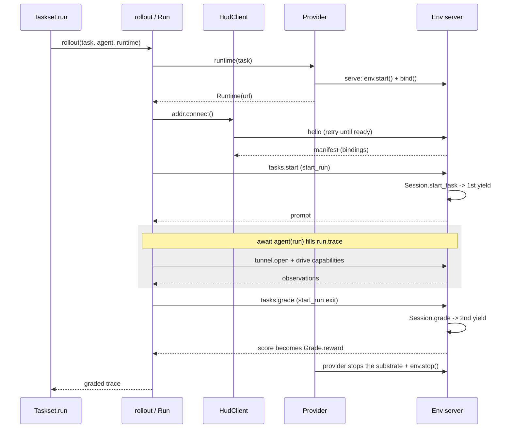

This page is a reading tour of one run through the real code. It begins with the definitions at
rest, enters `Taskset.run`, and follows the pointer into `rollout`, out to the environment server,
through `tasks.start`, into the agent, and back through `tasks.grade`. Irrelevant branches are
trimmed with `# ...`. The primary path has no `Task.verifier`; the optional verifier branch appears
in [grading and teardown](#grading-and-teardown).

On this page: [What we start with](#what-we-start-with) · [Start point: the scheduler](#start-point-the-scheduler) · [Into the rollout atom](#into-the-rollout-atom) · [Bringing up the server](#bringing-up-the-server) · [Connecting](#connecting) · [Starting the task](#starting-the-task) · [Checkpoint](#checkpoint) · [Driving the agent](#driving-the-agent) · [Grading and teardown](#grading-and-teardown) · [The whole chain](#the-whole-chain) · [Boundaries](#boundaries)

## What we start with

Before anything runs, we start with an `env.py` file with the **environment** declaration and **task
templates** registered on it. 

An `@env.template()` decorator turns an async generator into a `_TaskFactory` and stores it in
`env.tasks`. The generator body *is* the task: advancing the generator to first `yield` returns (yields) 
the prompt, the value sent back is
the answer, second `yield` is the score.

```python hud/environment/env.py
env = Environment("robolab", capabilities=[Capability.ssh(name="shell", url=...)])

@env.template()
async def fix_bug(difficulty: int):
    answer = yield f"Fix the bug (difficulty {difficulty})"   # 1st yield -> prompt
    yield 1.0 if check(answer) else 0.0                       # 2nd yield -> score
```

<Accordion title="Advancing fix_bug by hand">
```python
gen = fix_bug(difficulty=3)

prompt = await gen.__anext__()      # advance to the 1st yield; nothing to send in yet
print(prompt)                       # "Fix the bug (difficulty 3)"

score = await gen.asend("patched")  # resumes the paused yield with "patched" as its result
print(score)                        # 1.0, once `check("patched")` returns True
```
Calling `asend(value)` resumes the suspended `yield` expression with `value` - that's the moment
`answer = yield ...` gets populated - then runs the generator forward to the next `yield`, whose
argument becomes `asend`'s return value. The [`Session.start_task`](#starting-the-task) call later
in this walkthrough is exactly the `__anext__()` call above; [`Session.grade`](#grading-and-teardown)
is exactly the `asend(...)` call.
</Accordion>

```python hud/environment/env.py · Environment.template
def decorate(func):
    if not inspect.isasyncgenfunction(func):
        raise TypeError(...)                 # must be `async def ... yield`
    task = _TaskFactory(self, id or func.__name__, description, func, ...)
    self.tasks[task_id] = task               # registered on the env
    return task
```

Calling the factory runs nothing. It binds the args and returns a `Task` row - the row's `env` is
the environment's *name* (a string), not a live object.

```python hud/environment/env.py · _TaskFactory.__call__
def __call__(self, *args, **kwargs) -> EvalTask:
    from hud.eval.task import Task
    bound = self.sig.bind(*args, **kwargs)
    return Task(env=self.env.name, id=self.id, args=dict(bound.arguments))
```

A `Taskset` is just a named collection of those rows, indexed by slug:

```python
taskset = Taskset("bugs", [fix_bug(1), fix_bug(2)])
job = await taskset.run(agent, runtime=SubprocessRuntime("env.py"))   # <- the pointer starts here
```

## Start point: the scheduler

The pointer enters `Taskset.run`. It expands the rows, registers one `Job`, resolves placement
once, then fans out one `rollout` per (task, group) pair with `asyncio.gather`.

<Accordion title="Full code">
```python hud/eval/taskset.py · Taskset.run
async def run(self, agent, *, runtime=None, group=None, max_concurrent=None, ...):
    group = group or 1

    # expand: task x group; the `group` repeats of one task share a group_id (the GRPO group)
    expanded = []
    for task in list(self):
        group_id = uuid.uuid4().hex
        expanded += [(task, group_id) for _ in range(group)]

    if job is None:                                  # register one platform Job as the receipt
        job = await Job.start(name, group=group, ...)

    # placement chosen once for the whole batch (the runtime= you passed, or inferred)
    placement = runtime if runtime is not None else self._resolve_placement()
    sem = asyncio.Semaphore(max_concurrent) if max_concurrent else None

    async def _one(task, group_id):
        async with sem or contextlib.nullcontext():  # cap parallelism
            return await rollout(task, agent, runtime=placement,   # <- next hop
                                 job_id=job.id, group_id=group_id, rollout_timeout=...)

    job.traces.extend(await asyncio.gather(*(_one(t, gid) for t, gid in expanded)))
    return job
```
</Accordion>

<div className="guide-row">
<div className="guide-main">

<div className="part-label">1 · Expand rows into (task, group) pairs</div>

Each row in the taskset becomes `group` entries (default `1`), and the repeats of one task share a
`group_id` - the tag that later ties their rewards together into one GRPO group.

</div>
<div className="guide-aside">

<p className="aside-label">taskset.py · Taskset.run</p>

```python
async def run(self, agent, *, runtime=None,
               group=None, max_concurrent=None, ...):
    group = group or 1
    expanded = []
    for task in list(self):
        group_id = uuid.uuid4().hex
        expanded += [(task, group_id)
                     for _ in range(group)]
```

</div>
</div>

<div className="guide-row">
<div className="guide-main">

<div className="part-label">2 · Register the Job receipt</div>

A `Job` is the accumulator this call fills in and returns - every trace below lands in `job.traces`.
`Job.start` registers it with the platform so a running batch shows up before any rollout finishes.

</div>
<div className="guide-aside">

<p className="aside-label">taskset.py · Taskset.run</p>

```python
    if job is None:
        job = await Job.start(name, group=group,
                              ...)
```

</div>
</div>

<div className="guide-row">
<div className="guide-main">

<div className="part-label">3 · Resolve placement once, cap concurrency</div>

`placement` is resolved once into a single callable, not once per row - though that callable can
itself branch on the task (see [routing patterns](/v6/internals/placement#routing-patterns)). `max_concurrent`
becomes the semaphore's capacity, capping how many rollouts run at once.

</div>
<div className="guide-aside">

<p className="aside-label">taskset.py · Taskset.run</p>

```python
    placement = (runtime if runtime is not None
                 else self._resolve_placement())
    sem = (asyncio.Semaphore(max_concurrent)
           if max_concurrent else None)
```

</div>
</div>

<div className="guide-row">
<div className="guide-main">

<div className="part-label">4 · Fan out one rollout per pair, collect into the job</div>

`_one` is the unit `gather` schedules: acquire the semaphore (if there is one), then call
`rollout` - the next hop, for every placement, hosted included. `gather` starts every `_one` at
once, but the semaphore blocks all but `max_concurrent` of them until a running rollout exits
and frees a slot. `gather` returns the traces in order, and `job.traces` takes them as they are.

</div>
<div className="guide-aside">

<p className="aside-label">taskset.py · Taskset.run</p>

```python
    async def _one(task, group_id):
        async with sem or contextlib.nullcontext():
            return await rollout(
                task, agent, runtime=placement,   # <- next hop
                job_id=job.id, group_id=group_id,
                rollout_timeout=...)

    job.traces.extend(await asyncio.gather(
        *(_one(t, gid) for t, gid in expanded)))
    return job
```

</div>
</div>

Everything below happens inside one `rollout(task, agent, runtime=placement, ...)`.

## Into the rollout atom

`rollout` is the whole lifecycle for one task. The key structure is one `AsyncExitStack` that
stacks three context managers - the **provider**, the **session**, and the **`Run`** -
and unwinds them in reverse on the way out.

<Accordion title="Full code">
```python hud/eval/run.py · rollout
async def rollout(task, agent, *, runtime, job_id=None, group_id=None, ...):
    if job_id is None:                       # a lone rollout is a job of one
        job_id = (await Job.start(task.id)).id
    trace_id = trace_id or uuid.uuid4().hex
    if isinstance(runtime, HostedRuntime):   # the platform runs the whole rollout
        return await runtime.submit(task, agent, trace_id=trace_id, job_id=job_id, ...)

    with set_trace_context(trace_id):
        await trace_enter(trace_id, job_id=job_id, group_id=group_id, ...)

        async def _drive():
            nonlocal run, _phase
            async with contextlib.AsyncExitStack() as stack:
                addr    = await stack.enter_async_context(runtime(task))    # 1. provider -> Runtime
                session = await stack.enter_async_context(addr.connect())   # 2. connect -> a session
                async with start_run(session, task.id, task.args) as live:  # 3. tasks.start
                    run = live
                    run.trace.runtime = addr.url
                    _phase = "agent loop"
                    await agent(run)          #    agent fills run.trace
                                              #    on exit: revoke, final capture, tasks.grade
                _phase = "grading"

        await _drive()
        # ... failure isolation returns Trace.failed(...) or marks the trace errored ...
        await trace_exit(trace)
    return trace
```
</Accordion>

<div className="guide-row">
<div className="guide-main">

<div className="part-label">1 · Give the rollout a job and a trace</div>

A `rollout` called on its own (not through `Taskset.run`) still needs a `Job` and a trace id to
report against, so it opens its own job and mints a `trace_id` when neither arrives from the caller.

</div>
<div className="guide-aside">

<p className="aside-label">run.py · rollout</p>

```python
async def rollout(task, agent, *, runtime,
                   job_id=None, group_id=None, ...):
    if job_id is None:
        job_id = (await Job.start(task.id)).id
    trace_id = trace_id or uuid.uuid4().hex
```

</div>
</div>

<div className="guide-row">
<div className="guide-main">

<div className="part-label">2 · Open the AsyncExitStack: provider, then connect</div>

Two of the stack's three context managers enter here. The provider yields a `Runtime`; its
`connect` opens a live session on it - over the control channel, a `HudClient`. Exiting `stack`
later tears both down, in reverse order.

</div>
<div className="guide-aside">

<p className="aside-label">run.py · rollout · _drive</p>

```python
async with contextlib.AsyncExitStack() as stack:
    addr = await stack.enter_async_context(
        runtime(task))          # 1. provider -> Runtime
    session = await stack.enter_async_context(
        addr.connect())         # 2. connect -> a session
```

</div>
</div>

<div className="guide-row">
<div className="guide-main">

<div className="part-label">3 · Enter the Run, drive the agent</div>

The stack's third context manager is the `Run` itself: entering it sends `tasks.start`, exiting it
sends `tasks.grade` (messages to the environment server). Everything the agent does happens between those two lines, inside
`await agent(run)`.

</div>
<div className="guide-aside">

<p className="aside-label">run.py · rollout · _drive</p>

```python
async with start_run(session, task.id, task.args) as live:  # 3. tasks.start
    run = live
    run.trace.runtime = addr.url
    _phase = "agent loop"
    await agent(run)      #    fills run.trace
                          #    on exit: tasks.grade
_phase = "grading"
```

</div>
</div>

<div className="guide-row">
<div className="guide-main">

<div className="part-label">4 · Unwind and report</div>

`_drive` runs the whole nested block above; if it raises, failure isolation still produces a trace
(`Trace.failed`, or the run's trace marked errored) before `trace_exit` closes it and the graded - or
failed - trace returns.

</div>
<div className="guide-aside">

<p className="aside-label">run.py · rollout</p>

```python
await _drive()
# ... failure isolation returns Trace.failed(...)
# or marks the trace errored ...
await trace_exit(trace)
return trace
```

</div>
</div>

The pointer follows `stack.enter_async_context` in order. First stop: `runtime(task)`.

## Bringing up the server

`runtime(task)` calls whichever provider placement resolved - any callable of the shape
`(task) -> async context manager yielding a Runtime` (see [placement](/v6/internals/placement)). This whole
step is the **env side** of the protocol, the provider and the environment together, which the
[agent side](#connecting) then connects to. Two pieces make it up: the environment's serving code,
which runs identically inside whatever substrate holds it, and the provider, which brings that
substrate up and hands back a `tcp://` url reaching its control port.

### The serving code

Every substrate runs one entry point, `serve()` - the `python -m hud.environment.server` a
`SubprocessRuntime` child runs, and the `hud serve` a container CMD runs both land here. It starts the
env, binds the control channel, prints the bound port, and serves until torn down.

```python hud/environment/server.py · serve
async def serve(env, host="127.0.0.1", port=0):
    await env.start()                              # run @env.initialize hooks
    try:
        async with bind(env, host, port) as server:   # bind the control channel
            print(f"HUD_SERVE_PORT={server.sockets[0].getsockname()[1]}", flush=True)  # announce it
            await server.serve_forever()
    finally:
        await env.stop()                          # @env.shutdown hooks
```

The initialize hooks run *before* serving, so every capability is concrete by the time a client
connects.

```python hud/environment/env.py · Environment.start
async def start(self):
    if self._started:
        return
    self._started = True
    for hook in self._on_start:                     # @env.initialize
        await hook()                                # daemons up, add_capability(...) called here
    self._hooks_done = True
```

Then `bind` puts the env on one TCP port that carries both the control session and raw capability
tunnels - the [control channel](/v6/internals/control-channel). The bound port is the only thing the provider
needs back: child and container substrates announce it on stdout.

### The provider

`SubprocessRuntime` starts `python -m hud.environment.server <path> --env name` in a child
process, reads `HUD_SERVE_PORT=` from its output, and yields `Runtime(f"tcp://127.0.0.1:{port}")`,
the `addr` back in `rollout`. On exit it stops the process, whose `serve` runs `env.stop()`.

Every other provider runs that same serve entry point inside a different substrate and reaches its
port a different way:

| Provider | Substrate | Reaches the control port by |
| --- | --- | --- |
| `SubprocessRuntime` | a child process on this host | reading `HUD_SERVE_PORT=` from its stdout |
| `DockerRuntime` | a `docker run` container | publishing the port, reading the `docker port` mapping |
| `ModalRuntime` | a Modal sandbox | a raw-TCP tunnel (`unencrypted_ports`) |
| `DaytonaRuntime` | a Daytona sandbox | an SSH local-forward to a local port |
| `HUDRuntime` | a HUD-hosted env | a WebSocket tunnel behind a local TCP listener |
| `Runtime(url)` | one already served elsewhere | nothing - the url passes straight through |

`LocalRuntime` is the exception: it calls `env.start()` in this process and yields a runtime named
`local://<env>` with no control port. Its sessions drive the environment's task generators directly,
so the [connecting](#connecting) hop below - handshake, frames, tunnels - does not happen, and the
agent reaches each capability at the address the environment published. Blocking environment code
stalls other rollouts on the same event loop.

Whichever provider ran, the result is a runtime the pointer can open a session on. It returns to
`rollout` and enters the second context manager: `addr.connect()`, which for a served runtime opens
its control channel.

## Connecting

`Runtime.connect` retries the connect-and-`hello` handshake until the env answers (a freshly bound
port can accept before the env behind it is serving), for the runtime's `ready_timeout`. It then
yields a `HudClient` with its `manifest` ready and heartbeats the connection until the session
closes.

```python hud/runtime/core.py · Runtime.connect
@asynccontextmanager
async def connect(self, *, workspace_routes=(), connections=()):
    while True:                                     # until params["ready_timeout"]
        try:
            reader, writer = await asyncio.open_connection(host, port)
        except OSError:
            ...; continue                           # not accepting yet, retry
        client = HudClient(reader, writer, endpoint=(host, port))
        try:
            await client.hello(...)                 # handshake
            break
        except (EOFError, OSError):
            await client.close(); ...               # accepted but no env behind it, retry
    heartbeat_task = asyncio.create_task(heartbeat())   # a dead channel cancels the body
    try:
        yield client
    finally:
        heartbeat_task.cancel()
        await client.close()
```

`hello()` sends the frame and parses the reply into a `Manifest`. It creates a loopback forwarder
for every binding and records the routed local URL, so all capability traffic returns through the
control address. An optional `session_id` attaches to an open session instead of opening a fresh one;
the [suspended task](/v6/internals/control-channel#the-suspended-task) section describes that path.

```python hud/clients/client.py · HudClient.hello
async def hello(self, session_id=None):
    params = {} if session_id is None else {"session_id": session_id}
    result = await self._call("hello", params)      # -> server session
    bindings = [Capability.from_manifest(b) for b in result["bindings"]]
    self.manifest = Manifest(session_id=result["session_id"], bindings=bindings, ...)
    for capability in bindings:
        forwarder = await asyncio.start_server(
            partial(forward, capability), "127.0.0.1", 0
        )
        self._forwarders.append(forwarder)
        self._routes[capability.name] = ...          # capabilities carry the local route
    return self.manifest
```

On the server, the `hello` branch binds the session's connections and routes and answers with
the env identity and its capabilities (a connection's first `hello` opens the session, or
attaches to the open one it names; see the link above). Each branch produces a `result` that
the loop sends back as the reply:

```python hud/environment/server.py · _ControlChannel.handle (hello)
if method == "hello":
    # ... parse workspace_routes, connections and lease; open or attach the session ...
    session.bind(connections=connections, workspace_routes=routes)
    result = {"session_id": session.session_id,
              "env": {"name": env.name, "version": env.version},
              "bindings": [c.to_manifest() for c in env.capabilities]}
```

The client holds the manifest. Back in `rollout`, the pointer enters `start_run`.

## Starting the task

`start_run` is the third context manager. It sends `tasks.start`, normalizes the prompt the env
returns, and builds the `Run` with the session's capabilities, already at addresses this process
reaches.

```python hud/eval/run.py · start_run (enter)
started = await session.start_task(task_id, args)            # tasks.start
run = Run(prompt, _episode_capabilities(session.capabilities, started), connections)
run.trace.record(Step(source="task", task_call=TaskCall(phase="setup", ...)))
if raw_prompt is not None:
    run.trace.record(Step(source="user", messages=prompt))
```

```python hud/clients/client.py · HudClient.start_task
async def start_task(self, task_id, args=None):
    return await self._call("tasks.start", {"id": task_id, "args": args or {}})
```

The frame reaches the server's `tasks.start` branch, which starts the task on this connection's
`Session` (`hud/environment/session.py`):

```python hud/environment/server.py · _ControlChannel.handle (tasks.start)
elif method == "tasks.start":
    # ... check that 'id' names one of env.tasks and 'args' is an object ...
    result = await session.start_task(task_id, args)
```

`Session.start_task` replaces any task the session holds, instantiates the async generator, and
runs it to the **first yield** - the prompt. The session holds the suspended generator until
it is graded:

```python hud/environment/session.py · Session.start_task
async def start_task(self, task_id, args):
    await self.cancel()                             # replace this session's own task, if any
    task = self.env.tasks[task_id]
    gen = task.func(**_coerce_args(task.sig, args))   # make the generator
    prompt = await gen.__anext__()                  # run task fn to 1st yield
    self._held = (task, gen)
    return _jsonable(...)                           # -> back over the wire
```

The prompt travels back: `Session.start_task` -> server reply -> `client.start_task` ->
`run.prompt`.

## Checkpoint

The pointer is inside `start_run`'s block, just before `await agent(run)`. The session - here the
`HudClient` - has the `manifest`, and its server's `Session` holds the task suspended at its first
yield. `run` is a `Run` that holds:

<div className="step-list">

- `run.capabilities`, the environment's capabilities for this task, routed to this process,
- the prompt the env returned, as normalized turns on `run.prompt`,
- a `run.trace` containing the task setup step and, when a prompt was returned, its opening user
  step.

</div>

## Driving the agent

`rollout` hands the run to the agent. The agent contract is one method: `async __call__(run)`.

```python hud/eval/run.py · start_run (around the agent)
async with file_tracking_observer(session):
    try:
        yield run                       # rollout: await agent(run)
    finally:
        run.connections.clear()
        await session.revoke()          # access ends before the final capture and grading
```

```python hud/agents/base.py · Agent
class Agent(ABC):
    @abstractmethod
    async def __call__(self, run: Run) -> None:
        """Drive run to completion, filling run.trace (answer is trace.content)."""
```

Inside, the agent looks through `run.capabilities` and opens the ones it needs, then loops -
acting, observing, recording steps - until it has an answer. Everything it does lands on
`run.trace`; the final answer is `run.trace.content`.

```python
shell_cap = find_capability(run.capabilities, "ssh")
async with open_client(shell_cap) as shell:                 # live CapabilityClient
    ...                                                      # agent loop fills run.trace
cdp_url = find_capability(run.capabilities, "cdp").url      # or wire data for an SDK to dial
```

When `__call__` returns, the session cuts its routes, file tracking takes its final capture, and
`start_run` grades.

## Grading and teardown

On exit `start_run` sends `tasks.grade` with the answer taken from `trace.content`, and parses
the reply into a `Grade` (the env's `score` becomes `reward`). On a cancel it cancels the task
instead of grading.

```python hud/eval/run.py · start_run (exit) + _grade
except (asyncio.CancelledError, KeyboardInterrupt):
    await session.cancel(); raise
...
answer = {"answer": run.trace.content}
evaluation = await session.grade(answer)          # tasks.grade
run.trace.grade = parse_grade(evaluation)         # score -> trace.grade.reward
run.trace.record(Step(source="task", task_call=TaskCall(phase="evaluate", ...)))
```

The server's `tasks.grade` branch grades the session's task:

```python hud/environment/server.py · _ControlChannel.handle (tasks.grade)
elif method == "tasks.grade":
    if not session.has_task:
        raise HudProtocolError(-32600, "no task in progress")
    result = await session.grade(params)
```

`Session.grade` sends the answer into the paused generator (optionally wrapped as `Answer[T]`
when `returns=` was declared), which advances past the first yield, evaluates, and yields the
**score**:

```python hud/environment/session.py · Session.grade
async def grade(self, payload):
    (task, gen), self._held = self._held, None
    evaluation = await gen.asend(_build_answer(task.return_type, payload))  # 2nd yield
    # ... normalize dict / EvaluationResult ...
    return {"score": _score_value(evaluation)}
```

The score travels back: `Session.grade` -> server reply -> `client.grade` -> `parse_grade`
-> `trace.grade.reward`.

When `task.verifier` is present, the actor grade is provisional. A verifier in the same environment
with no row-level runtime configuration starts on the existing client. Otherwise the actor client
and provider exit before the same provider is called with the verifier row. `_verify` starts that
task without an agent loop and immediately grades it with the actor result frame; its evaluation
replaces the actor grade. The full phase contract is documented in
[verifier environments](/v6/experimental/verifier-environments#provisioning-order).

The `AsyncExitStack` unwinds in reverse: the session closes the client (forwarders and socket),
then the provider context exits and tears the substrate down - for `SubprocessRuntime` it
terminates the child, whose `serve` runs `env.stop()` (`@env.shutdown`) on the way out; for
`LocalRuntime`, whose session cancelled any task it left suspended, it runs `env.stop()` itself.
Back in `rollout`,
`trace_exit(trace)` reports the trace and the graded trace returns to `Taskset.run`, which collects it
into `job.traces`.

## The whole chain

Every hop above, in order:

<div className="step-list">

1. `Taskset.run` - expand rows, register a `Job`, resolve placement, `gather` one `rollout` per (task, group).
2. `rollout` - open an `AsyncExitStack`: provider, then connect, then `start_run`.
3. `runtime(task)` - bring the env up in its substrate: `SubprocessRuntime` spawns the serve entry point and reads its announced port; `LocalRuntime` starts the env in this process instead, and its sessions skip the wire.
4. `serve` (in the substrate) - `env.start()` (initialize hooks), `bind()` a TCP server, `serve_forever()`; the provider yields a `Runtime(url)`.
5. `addr.connect()` - retry until ready, `HudClient.hello()` -> server returns the `manifest`.
6. `start_run` - `client.start_task` -> `tasks.start` -> `Session.start_task` runs the generator to the first yield -> the prompt back on `run.prompt`.
7. **Checkpoint** - `run` holds the routed capabilities and the prompt; the client holds the manifest and the server's `Session` the suspended task.
8. `await agent(run)` - agent opens capabilities with `open_client`, loops, fills `run.trace` (answer on `trace.content`); the session then cuts its routes.
9. `start_run` exit - `client.grade` -> `tasks.grade` -> `Session.grade` resumes the generator to the second yield -> provisional `score` -> `trace.grade.reward`.
10. Optional verifier - reuse the live substrate or finish actor cleanup and acquire the verifier substrate; start and grade the verifier with the actor result; replace the actor grade.
11. Unwind - close the active client, stop the substrate (`serve` runs `env.stop()`), `trace_exit`, return the graded trace to `Taskset.run`.

</div>



## Boundaries

This reading path exposes the boundaries encoded by the rollout engine.

<div className="step-list">

- **Each provider acquisition yields one runtime.** It is a control-channel address - a process,
  one container, or a Compose project whose `main` service owns the channel - or, from
  `LocalRuntime`, an environment started in this process. A verifier in another environment causes
  a second acquisition after the actor acquisition exits.
- **A session holds one suspended task.** A `_ControlChannel` keys its `Session`s by id, so
  concurrent sessions each own their own task, and a session leased past its connection stays
  open for a later one to attach and grade (see the
  [control channel](/v6/internals/control-channel#the-suspended-task)). Vectorized robot sims reuse that
  shape: N sessions on one control port, each claiming a bridge slot by token.
- **The agent loop runs in the caller's process.** Every provider except `HostedRuntime` is
  *client-here*: the substrate can be anywhere, but `agent(run)` executes locally. With the
  default `LocalRuntime` the env runs in this same process too, with no control channel, so its
  hooks share the caller's event loop and blocking env code stalls concurrent rollouts;
  `SubprocessRuntime` and `DockerRuntime` move the env to its own substrate, where hooks run
  isolated from the caller.
- **Every capability is concrete by `hello` time.** `env.start()` runs all initialize hooks before
  serving, and the manifest is negotiated once. A capability published later will not appear in an
  already-connected client.
- **A template generator is single-use per start.** `grade` closes it after the second yield, so
  one start grades exactly once; re-running the task means a fresh `tasks.start`.
- **Placement is chosen once per batch.** `Taskset.run` resolves one provider for all rows. Per-row
  heterogeneity is possible only because the `Provider` contract takes the `task` and can branch on
  it - the engine never does.

</div>
